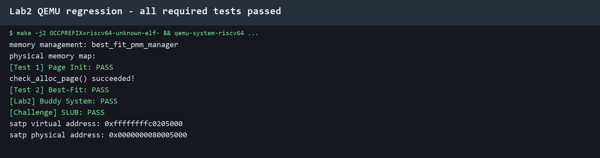
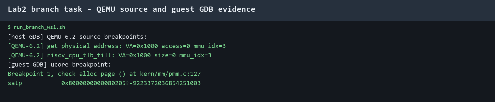

# Lab2 物理内存与页表实验报告

## 1. 实验目标与整体逻辑

本实验的核心目标有三个：理解内核如何发现和组织物理内存，理解连续物理页分配算法，理解 Sv39 页表如何把虚拟地址翻译为物理地址。整个实验不是把几个独立函数拼在一起，而是沿着“发现内存—建立页描述符—接入页分配器—建立启动页表—观察地址翻译”的顺序展开。

内核启动流程可以概括为：

```text
OpenSBI / QEMU 提供设备树
        ↓
kern_entry：建立启动页表并写入 satp
        ↓
kern_init：进入 C 代码
        ↓
pmm_init
  ├─ init_pmm_manager
  ├─ page_init
  ├─ pmm_manager->init_memmap
  └─ check_alloc_page
        ↓
alloc_pages / free_pages
```

本次实现中，正式注册并使用的是 Best-Fit；Buddy System 作为任务三的独立页分配器完成并通过独立测试；SLUB 作为 Challenge 完成并建立在页分配器之上。这样可以同时满足必做任务的默认管理器要求和扩展算法的验证要求。

## 2. 物理内存初始化

### 2.1 `page_init()` 的作用

`page_init()` 位于 `kern/mm/pmm.c`，负责把设备树提供的 DRAM 信息转换为内核可以管理的 `struct Page` 数组和空闲页区间。主要步骤如下：

1. 通过 `get_memory_base()` 和 `get_memory_size()` 读取物理内存起始地址和大小。
2. 设置 `va_pa_offset`，保存内核直接映射区中虚拟地址与物理地址之间的固定差值。
3. 根据物理内存结束地址计算可管理的页数 `npage`。
4. 将 `struct Page` 描述符数组放在内核镜像结束位置之后，并按页对齐。
5. 先把所有页描述符设置为 Reserved，防止内核镜像和描述符数组占用的物理页被重复分配。
6. 从描述符数组结束位置开始，到物理内存末尾为止，截取完整页面并调用 `init_memmap()` 交给当前物理页分配器。

实现时必须区分四种对象：虚拟地址、物理地址、物理页号和 `struct Page *`。例如，链接符号 `end` 是内核虚拟地址，计算物理内存布局前需要使用 `PADDR(end)`；物理页号再通过 `pa2page()` 转换为描述符指针。不能把 `struct Page *` 当作物理地址直接参与页号计算。

### 2.2 任务一 Prompt 与实现规格

任务一的规格（spec）是：实现 `static void page_init(void)`，不能改变 `pmm_manager` 接口；必须使用设备树的内存范围，设置 `va_pa_offset`、`npage` 和 `pages`，排除 OpenSBI、内核镜像和 Page 描述符数组，且只有在剩余区域包含完整页面时才调用 `init_memmap()`。

实际使用的 Prompt 如下：

```text
请阅读当前 ucore Lab2 的 pmm.c、pmm.h、memlayout.h、mmu.h、dtb.h、default_pmm.c 和链接脚本，完成 kern/mm/pmm.c 中标有 lab2 和 YOUR CODE 的 page_init()。要求：

1. 使用 get_memory_base() 和 get_memory_size() 获取设备树报告的物理内存范围；
2. 正确设置 va_pa_offset、npage 和 pages；
3. 区分虚拟地址、物理地址、物理页号和 struct Page 指针；
4. 排除 OpenSBI、内核镜像和 Page 描述符数组占用的空间；
5. 将描述符数组之后的完整物理页交给当前 pmm_manager->init_memmap；
6. 内存范围无效或没有完整空闲页时调用 panic，不得注册非法区间；
7. 保持原有测试和 lab2 注释，使用 GNU99 和当前 RISC-V Sv39 地址模型；
8. 解释每个地址转换和对齐操作的理由。
```

### 2.3 Challenge：操作系统不知道可用物理内存范围怎么办

如果操作系统不能预先写死机器的物理内存范围，就不能简单假设“从某个地址到某个固定地址全部可用”。可采用以下方法：

- 在 RISC-V 平台上读取固件传入的设备树 DTB，从 `/memory` 节点获得物理内存起始地址和长度；
- 读取固件提供的内存映射表或启动参数；在 x86 上通常对应 BIOS/E820 或 UEFI memory map；
- 由固件或 Bootloader 先探测内存，再把探测结果通过启动协议传给内核；
- 对设备树报告的范围再结合内核镜像、OpenSBI、设备 MMIO 区域和保留区间做裁剪；
- 对范围按页对齐，只有完整且没有重叠的区间才能加入物理页分配器；如果没有可靠的描述信息，应拒绝初始化，而不能把未知地址当作可用内存。

本工程中使用的是 DTB。`dtb_init()` 解析设备树，`get_memory_base()` 和 `get_memory_size()` 提供内存范围，`page_init()` 再完成保留区裁剪。因此设备树不是分配器本身，而是分配器的硬件资源输入。

## 3. First-Fit 连续物理内存分配

### 3.1 核心函数理解

First-Fit 位于 `kern/mm/default_pmm.c`，关键函数及职责如下：

- `default_init()`：初始化空闲链表和空闲页计数。
- `default_init_memmap(base, n)`：把一段连续页面清空状态，令第一个页面的 `property=n`，并插入按地址排序的空闲链表。
- `default_alloc_pages(n)`：从链表头开始寻找第一个 `property >= n` 的块；如果块更大，就切分出前 `n` 页，将剩余块重新插回链表。
- `default_free_pages(base, n)`：清除页面保留状态，按地址插回空闲链表，再检查前后相邻块并合并。

`property` 只在空闲块的首个页面上表示块大小，`PG_property` 表示这个页面是空闲块头。`nr_free` 表示所有空闲页的总数量，和链表中块的数量不是同一个概念。

### 3.2 First-Fit 的过程

初始化时，分配器把所有连续可用页看成一个大块。分配请求从链表低地址端开始搜索，第一个足够大的块就是结果；如果块大小大于请求，则切分为“已分配前缀”和“剩余空闲后缀”。释放时把页面按地址插回链表，若前一块结束地址等于当前块起始地址，就把当前块并入前一块；同理检查后一块。合并的本质是把两个相邻的连续区间重新表示为一个更大的空闲区间。

### 3.3 练习问题：First-Fit 是否还有改进空间

有改进空间。

1. 当前查找是线性扫描，最坏时间复杂度为 O(n)，可以使用按大小组织的分离链表、平衡树或位图索引。
2. First-Fit 总是偏向低地址块，长期运行后低地址区域可能被切得很碎；可以使用 Next-Fit、Best-Fit 或按大小分级的分配策略。
3. 释放时依靠地址链表扫描查找相邻块，插入和合并也可能需要 O(n)；可以维护地址索引或边界标签。
4. First-Fit 只处理页粒度的连续分配，不能直接解决任意大小对象的内部碎片问题；可以在页分配器之上增加 Slab/SLUB。
5. 多核系统中还需要锁、每 CPU 空闲链表和批量转移机制，否则全局链表会成为竞争热点。

## 4. Best-Fit 连续物理内存分配

### 4.1 任务二 Prompt 与实现规格

任务二的 spec 是：保持 `basic_check()` 和 `best_fit_check()` 不变，按照 `struct pmm_manager` 补齐 Best-Fit 的初始化、内存区注册、分配、释放、空闲页统计和检查接口，并在 `pmm.c` 中注册为当前管理器。

实际使用的 Prompt 如下：

```text
请阅读当前 ucore Lab2 的 pmm.h、memlayout.h、list.h、default_pmm.c、pmm.c 和 best_fit_pmm.c。请在 best_fit_pmm.c 中完成所有标有 lab2 和 YOUR CODE 的位置，设计并实现一个兼容 struct pmm_manager 的 Best-Fit 连续物理页分配器。

要求：
1. 保持 basic_check() 和 best_fit_check() 的内容不变；
2. 实现 init、init_memmap、alloc_pages、free_pages、nr_free_pages 和 check；
3. 分配时遍历空闲块，选择满足 n 且 property 最小的块；
4. 支持大块切分、释放后地址有序插入和前后相邻块合并；
5. 正确维护 PG_property、property、PageReserved 和 nr_free；
6. 导出 best_fit_pmm_manager，并说明 pmm.c 中如何切换默认管理器；
7. 不使用 malloc/free，不改动测试函数，不破坏 RISC-V 内核环境；
8. 保留 lab2 注释，并把 YOUR CODE 替换为指定学号。
```

### 4.2 Best-Fit 与 First-Fit 的差异

Best-Fit 仍然使用连续空闲块和 `property`，区别是它不在找到第一个满足条件的块时停止，而是扫描所有空闲块，记录大小最小但足够的块。这样可以减少一次分配对大块的破坏，但每次分配的搜索成本更高。

### 4.3 练习问题：Best-Fit 是否还有改进空间

有改进空间。

- 当前实现每次都线性扫描，复杂度为 O(n)。可以用按块大小排序的平衡树或大小分级链表，把查找成本降到 O(log n) 或接近 O(1)。
- 如果只按大小组织块，释放时不容易快速定位物理相邻块；可以同时维护“按地址索引”和“按大小索引”。
- 同样大小的候选块可以增加地址、NUMA 节点、缓存局部性等选择策略。
- Best-Fit 可能产生许多很小的剩余碎片，应设置最小剩余块阈值；如果切分后剩余块太小，可以整块分配。
- 在多核环境中应按 CPU 或内存节点维护局部空闲区，并用锁保护全局结构。

## 5. Buddy System（任务三，不属于 Challenge）

### 5.1 实现与模块理解

代码位于 `kern/mm/buddy_pmm.c` 和 `kern/mm/buddy_pmm.h`。Buddy System 为每个阶维护一个空闲链表，order 为 `k` 时，一个块包含 `2^k` 个页面。分配过程先把请求页数向上取整到 2 的幂，再从目标阶或更高阶寻找块；高阶块不足时逐级拆成两个相同大小的伙伴。释放时计算相对块起始位置的异或值：

```text
buddy_index = block_index XOR (1 << order)
```

如果对应伙伴也处于空闲状态，就从当前阶链表中移除伙伴，把两个块合并为上一阶块，并继续向上检查。这个算法的优点是伙伴定位快、合并规则简单；缺点是请求 3 页可能要占 4 页，存在内部碎片。

### 5.2 两份 Buddy Prompt

第一份 Prompt：

```text
请阅读当前 ucore Lab2 的 pmm.h、memlayout.h、list.h、default_pmm.c 和 pmm.c，参考 struct pmm_manager 接口，从零设计一个 Buddy System 物理页分配器。

要求：每个 order 管理 2^order 页；实现 init、init_memmap、alloc_pages、free_pages、nr_free_pages 和 check；非 2 的幂请求向上取整；高阶块可拆分；释放时使用相对索引 XOR 找伙伴并递归合并；导出 buddy_pmm_manager；不修改现有 Best-Fit 测试，不使用宿主机标准库，并说明 Page 状态字段和全局 pages 的处理方式。
```

第二份 Prompt：

```text
请为上一条 Prompt 生成的 Buddy System 编写独立内核测试，不修改 basic_check 和 best_fit_check。测试使用 64 页独立 Page 数组，覆盖：初始空闲页数、分配 3 页实际占用 4 页、不同阶块共存、释放后伙伴递归合并、64 页耗尽、再次分配失败、释放后恢复 64 页以及返回地址不重叠。测试结束必须恢复全局 pages 指针和原分配器状态，成功输出 [Lab2] Buddy System: PASS。
```

### 5.3 测试覆盖与边界

- 3 页请求验证向上取整和内部碎片；
- 8 页请求与拆分后的其他阶块共存，验证空闲链表分阶；
- 释放相邻伙伴验证 XOR 定位和递归合并；
- 64 页整块分配验证最高阶块耗尽；
- 耗尽后再次申请验证失败路径；
- 全部释放后空闲页数恢复 64，验证没有泄漏；
- 不同申请返回地址不重叠，验证分配范围边界正确。

测试输出为 `[Lab2] Buddy System: PASS`。Buddy 是本次任务三，不能误写成 Challenge。

## 6. SLUB Challenge：任意大小内存对象

### 6.1 实现与模块理解

代码位于 `kern/mm/slub.c` 和 `kern/mm/slub.h`。SLUB 使用两层结构：下层通过 `alloc_page()` 或 `alloc_pages()` 获得页，上层把页划分成多个相同大小的对象。小对象使用单页 slab；超过一页的对象向上取整为连续页，并放入大对象记录表。静态数组保存 slab 元数据和大对象记录，不依赖宿主机 `malloc/free`。

分配时先把对象大小按指针宽度对齐，计算对象步长和一个页能容纳的对象数，查找有空闲槽位的 slab；没有合适 slab 时申请新页。释放时先检查大对象表，再通过地址范围和步长找到小对象所在 slab，清除位图；如果整个 slab 为空，则把底层页归还给 PMM。重复释放和非法指针会被拒绝。

### 6.2 两份 SLUB Prompt

第一份 Prompt：

```text
请阅读当前 ucore Lab2 的 alloc_page、alloc_pages、free_page、free_pages、page2pa、va_pa_offset 和无标准库约束，在没有现成 SLUB 框架的情况下，从零实现简化 SLUB 任意大小对象分配模块。

要求：提供 slub_init、slub_alloc(size)、slub_free(ptr) 和 slub_challenge_check；不超过一页的对象按对象大小建立单页 slab；对象至少按指针宽度对齐；大于一页的对象使用连续页并记录页数；不使用 malloc/free；释放空 slab 时归还底层页；检查无效指针和重复释放；使用静态元数据上限；保留 Challenge 标记并说明边界条件。
```

第二份 Prompt：

```text
请针对上一条 Prompt 设计内核态 SLUB 测试。不得使用宿主机 malloc。测试必须验证 size=0、1 字节、24 字节、1000 字节、大于 PGSIZE 的跨页对象；对每个对象写入并读回；检查多个对象地址不重复；释放后 nr_free_pages 恢复；检查空 slab 回收；成功输出 [Challenge] SLUB: PASS，失败通过 assert 暴露原因。
```

### 6.3 测试覆盖与边界

测试覆盖零大小拒绝、最小对象、需要对齐的对象、接近页大小的对象和跨页大对象。写入/读回验证对象边界没有越界；比较释放前后的 `nr_free_pages()` 验证 slab 和大对象页均归还；多个不同大小对象地址不相同，验证静态记录没有错误复用。

## 7. Sv39 页表建立与使用

### 7.1 启动页表的建立

`entry.S` 中的 `boot_page_table_sv39` 占用一个 4 KiB 页，可以放下 512 个 8 字节 PTE。前 511 个 PTE 为 0，表示未映射；最后一个 PTE 的 PPN 为 `0x80000`，并设置 `V/R/W/X/A/D`，把虚拟地址区间 `[0xffffffffc0000000, 0xffffffffffffffff]` 映射到物理区间 `[0x80000000, 0xc0000000)`。这是一个 1 GiB 的 gigapage 映射，因此不需要继续分配下两级页表。

启动时先把页表虚拟地址减去 `0xffffffff40000000` 得到物理地址，再右移 12 位得到 PPN；随后将 Sv39 的 MODE 值 `8 << 60` 与 PPN 合并写入 `satp`，最后执行 `sfence.vma` 清空旧地址转换缓存，再把栈和 PC 切换到内核高地址虚拟空间。

### 7.2 Sv39 地址拆分

Sv39 使用 39 位有效虚拟地址，低 12 位是页内偏移，剩余 27 位拆成三个 9 位索引：

```text
VA[38:30]  -> VPN[2]
VA[29:21]  -> VPN[1]
VA[20:12]  -> VPN[0]
VA[11:0]   -> 页内偏移
```

每个索引乘以 8 得到当前页表中 PTE 的偏移。PTE 的第 53 到 10 位保存下一级页表或叶子页的 PPN，第 9 到 0 位保存 V、R、W、X、U、G、A、D 等状态和权限位。若 R/W/X 全为 0，PTE 是指向下一级页表的内部节点；如果其中至少一个权限位为 1，它就是叶子映射，可以直接生成物理地址。一级叶子对应 1 GiB，二级叶子对应 2 MiB，三级叶子对应 4 KiB。

## 8. 分支任务：GDB 调试页表查询过程

### 8.1 两个 GDB 的职责

来宾侧是 QEMU 里面运行的 ucore/RISC-V 系统，使用 `riscv-none-elf-gdb` 连接 QEMU GDB stub，观察 ucore 的 PC、指令、`satp` 和页表；宿主侧是 Windows/Linux 上运行的 QEMU 进程，使用普通 x86 GDB 附加 QEMU，观察 QEMU 模拟 MMU、TLB 和页表遍历的 C 代码。

手工观察时可分为三个终端；本次最终提交的脚本把启动和清理自动化，避免 WSL 的 ptrace 限制：

1. 终端一启动带 `-S -s` 的调试版 QEMU，CPU 暂停；
2. 终端二用普通 GDB 启动调试版 QEMU（若环境允许，也可以附加已有 QEMU PID），执行 `handle SIGPIPE nostop noprint`，设置 QEMU 源码断点后 `continue`；
3. 终端三运行 `make gdb` 或 RISC-V GDB 连接 `localhost:1234`，在 ucore 中设置断点并继续执行。

实验文档要求 QEMU 4.1.1 使用 `--enable-debug` 重新编译且不 `make install`。本机 Windows 侧的旧版工具链和 QEMU 发行版存在 DLL 兼容问题，因此本次在 WSL Ubuntu-22.04 中重新完成：普通回归使用解包的 QEMU 6.2.0，分支任务使用官方 QEMU 6.2.0 源码、`--enable-debug` 构建的 `riscv64-softmmu` 调试版，未执行 `make install`。版本与文档要求不同，但调用路径和调试目标相同，已在报告中明确记录。

### 8.2 实际来宾侧观测

使用 `tools/debug_page_table.ps1` 启动 QEMU，并由 `tools/gdb_page_table.gdb` 在 `check_alloc_page` 停止。此时 `kern_init()` 已完成 `pmm_init()`，并且 `satp` 仍指向启动页表。实际日志保存在 `report/logs/gdb_page_table_guest.txt`。

关键输出：

```text
Breakpoint 1, check_alloc_page () at kern/mm/pmm.c:152
satp           0x8000000000080205
VA = 0x00000000c020166c
VPN2 = 0x1ff, VPN1 = 0x001, VPN0 = 0x001
offset = 0x66c
SATP.PPN = 0x80205, root_pa = 0x0000000080205000
root_va = 0x00000000c0205000
L2 PTE address = 0x00000000c0205ff8
0xffffffffc0205ff8:  0x00000000200000cf
```

GDB 在打印 PC 时可能省略高位规范扩展，但反汇编符号是 `0xffffffffc020166c`。`satp` 的 MODE 为 8，表示 Sv39；PPN 为 `0x80205`，根页表物理地址为 `0x80205000`。对观测虚拟地址进行拆分得到 `VPN[2:0]=[0x1ff,0x001,0x001]` 和偏移 `0x66c`。根页表第一级 PTE 地址是 `root_pa + VPN2 * 8`。由于 GDB 的 `x` 命令在当前目标中按来宾可访问地址读取，脚本用直接映射区的 `root_va` 访问对应页表内容。

读取到的 `0x200000cf` 中 `V=1`，并且 `R/W/X` 不全为 0，说明这是叶子 PTE，而不是下一级页表指针。它映射的是 1 GiB gigapage。物理地址计算为：

```text
PA = (PTE.PPN | VA 的低 18 位 VPN) << 12 | VA[11:0]
```

这里的页表项已经直接完成 1 GiB 映射，因此不需要再访问 VPN[1] 和 VPN[0] 对应的下级页表。

### 8.3 QEMU 中的调用路径和关键分支

一次访存可以抽象为：

```text
TCG 生成/执行访存
  -> QEMU 通用 TLB 查询
  -> TLB 命中：使用缓存的页框和权限
  -> TLB 未命中：riscv_cpu_tlb_fill()
  -> get_physical_address()
  -> 读取 SATP、确定模式和级数
  -> for 循环逐级读取 PTE
  -> 权限、V/A/D、PMP 和对齐检查
  -> tlb_set_page() 填充 TLB
  -> 继续完成物理地址访问
```

在本次实际运行的 QEMU 6.2.0 `target/riscv/cpu_helper.c` 中，`get_physical_address()` 的关键分支包括：

- `mode == PRV_M` 或没有 MMU 特性时直接令 `physical = addr`，即 Bare/机器态不查页表；
- 根据 `satp.MODE` 选择 Sv32、Sv39、Sv48 或 Bare，并设置 `levels`、索引位数和 PTE 大小；
- 循环中计算 `idx` 和 `pte_addr`，通过 `ldq_phys()` 读取 PTE；
- `V=0` 时翻译失败；R/W/X 全为 0 时把 PTE 的 PPN 作为下一级页表基址继续循环；
- 叶子 PTE 还要检查保留权限组合、用户权限、PPN 对齐、读/写/取指权限；
- 翻译成功后调用 `tlb_set_page()`，把虚拟页到物理页的映射放入 TLB。

### 8.4 “三个循环”和“两行取 PTE”到底在做什么

页表遍历的核心只有一个显式 `for` 循环，但它执行三次，因此容易被理解成“三个循环”。`levels=3` 表示 Sv39 有三级，`ptshift` 初始为 18，每轮减 9：

```c
for (i = 0; i < levels; i++, ptshift -= ptidxbits) {
    idx = (addr >> (PGSHIFT + ptshift)) & ((1 << ptidxbits) - 1);
    pte_addr = base + idx * ptesize;
    pte = ldq_phys(cs->as, pte_addr);
    ppn = pte >> PTE_PPN_SHIFT;
    if (!(pte & PTE_V)) fail;
    else if (!(pte & (PTE_R | PTE_W | PTE_X))) base = ppn << PGSHIFT;
    else success;
}
```

第一轮使用 VPN[2] 从根页表选 PTE；如果它是内部节点，`base` 被更新为该 PTE 指向的下一级页表物理地址。第二轮使用 VPN[1]，第三轮使用 VPN[0]。所以 `idx` 计算的是“本级页表中的第几个表项”，`pte_addr = base + idx * ptesize` 计算的是“这个表项在物理内存中的地址”，`ldq_phys()` 才是从当前页表取出 64 位 PTE 的动作。取出的 PTE 如果 R/W/X 全为 0，就不是最终映射，而是下一级页表的地址；否则它是叶子，可以结束遍历。

### 8.5 QEMU 如何模拟 TLB，是否先查 TLB

是的，逻辑顺序是先查 TLB，TLB 未命中后才查页表。QEMU 通用 TCG 访存路径先查 CPU 的软件 TLB；命中时直接得到物理页和权限，不调用 RISC-V 页表遍历。未命中时进入架构相关的 `riscv_cpu_tlb_fill()`，它调用 `get_physical_address()`，成功后使用 `tlb_set_page()` 填入 TLB。

宿主机 GDB 的脚本 `tools/gdb_qemu_pagewalk.gdb` 设置了 `riscv_cpu_tlb_fill` 和 `get_physical_address` 两个断点，并打印访问地址、访问类型和 `mmu_idx`。第一次访问某页通常会在 TLB 未命中路径观察到页表遍历；继续执行后再次访问同一页，如果 TLB 项仍有效，通常不会再次进入页表遍历函数。

### 8.6 QEMU 的 TLB 与真实 CPU TLB 的区别

二者的逻辑目标相同：缓存虚拟页号到物理页号的映射，避免每次访存都完整遍历页表。但实现方式不同：

- 真实 CPU 的 TLB 是硬件中的高速缓存，由处理器内部的比较、替换和权限检查电路完成；
- QEMU 的 TLB 是宿主机内存中的软件数据结构，由 C 代码和 TCG 运行时维护；
- 真实 CPU 的页表遍历由硬件 MMU 完成，QEMU 则在 `get_physical_address()` 中用 `ldq_phys()` 等函数模拟读页表；
- 真实 CPU 的 TLB 刷新通过 `sfence.vma` 等架构指令触发硬件行为；QEMU 需要把该指令翻译为软件 TLB 刷新；
- QEMU 还要维护宿主机地址空间、设备内存和模拟 CPU 状态，因此会有 `mmu_idx`、PMP、内存区域等仿真层参数。

在 Bare 模式或机器态下，QEMU 的 `get_physical_address()` 会直接返回 `physical = addr`，不查 SATP 和三级页表；开启 Sv39 后才会根据权限模式、SATP 和 VPN 逐级查表。这正是实验要求比较的两条路径：两者都可能经过 QEMU 的通用访存代码，但分页关闭时没有页表翻译，分页开启且 TLB 未命中时才进入 RISC-V 页表查询。

### 8.7 调试中的有趣细节

1. GDB 连接 QEMU 时，Windows 沙箱最初禁止 QEMU 监听本地调试端口，出现套接字错误 10013；获得本机回环调试权限后，`-S -gdb` 和 RISC-V GDB 连接正常。
2. `satp` 中保存的是根页表物理页号，而不是完整物理地址，必须左移 12 位才能得到根页表地址。
3. GDB 打印的 PC 有时显示为 `0x00000000c020166c`，但反汇编符号是 `0xffffffffc020166c`，这是 Sv39 规范地址高位符号扩展与 GDB 显示方式的差异。
4. 直接用物理地址 `0x80205ff8` 访问页表会失败，因为当前 GDB 目标按来宾地址访问；使用内核直接映射虚拟地址 `0xffffffffc0205ff8` 才能读出 PTE。
5. 启动页表使用一个 1 GiB gigapage 叶子项，所以观察到根页表 PTE 后就完成了翻译，不会出现三次都访问普通下级页表的现象。

## 9. AI 辅助开发记录、Bug 与解决方法

本实验使用 AI 的原则是先给出源码接口、约束和测试要求，再让 AI 生成候选实现，最后通过编译、QEMU 输出和测试结果验证，而不是直接把生成代码视为正确答案。

### 9.1 Prompt 造成或暴露的问题

1. **工具链前缀不一致**：原 Makefile 使用 `riscv64-unknown-elf-`，本机工具链为 `riscv-none-elf-`。通过构建脚本传入 `GCCPREFIX=riscv-none-elf-` 解决。
2. **GCC 架构选项不足**：新版 GCC 汇编 `sd` 和 CSR 指令时报错。检查指令集后在 Makefile 中增加 `-march=rv64gc -mabi=lp64d`。
3. **Best-Fit 只实现算法却没有注册**：初版代码完成了函数，但 `init_pmm_manager()` 仍使用旧管理器。补充 `best_fit_pmm_manager` 并切换注册点后，启动输出变为 `best_fit_pmm_manager`。
4. **Buddy 测试污染正式全局状态**：独立测试临时替换了 `pages`，如果不恢复会影响后续分配和 SLUB。测试结束增加恢复 `pages`、管理器和计数状态的逻辑。
5. **SLUB 误用标准库**：初版使用了宿主机 `malloc` 或缺少内核 `string.h` 包含，不能在内核环境编译。改为静态元数据、`alloc_pages/free_pages` 和内核自己的字符串头文件。
6. **GDB 脚本连接顺序错误**：先连接远程目标再执行 `file` 会重置目标状态；改为先加载 `bin/kernel`，再 `target remote`，最后执行断点脚本。
7. **页表读取地址错误**：把物理地址直接交给 GDB 的 `x` 命令导致无法访问；根据内核直接映射关系改为访问对应的高地址虚拟地址。
8. **页表 PTE 计算表达式类型错误**：GDB 把 `$pc` 当作地址类型参与位运算时报错；脚本显式转换为 `unsigned long`，并补齐 Sv39 规范地址高位。

### 9.2 一次典型 AI 交互的思路

以页表 GDB 为例，先提出“需要两个 GDB 吗、哪个 GDB 调试 QEMU、如何观察 TLB miss 和页表遍历”的问题；AI 根据双层架构给出宿主机 GDB 和 RISC-V GDB 的职责划分。随后把实验要求、Makefile、QEMU 启动参数和工具链路径提供给 AI，要求生成可执行脚本。第一次运行出现 10013 端口权限错误，于是根据错误定位到环境权限，而不是修改内核。连接成功后，GDB 又报告 PTE 物理地址不可访问，进一步分析得出 GDB 访问的是来宾虚拟地址，需要加上内核直接映射偏移。最后用日志中的 `satp`、VPN 索引和 PTE 值反向检查脚本计算是否与 `entry.S` 的映射一致。

这个过程说明 AI 适合帮助整理调用链、生成命令模板和解释错误，但断点是否命中、地址是否可访问、测试是否通过仍必须由编译器、QEMU、GDB 输出和源代码交叉验证。

## 10. 重要知识点与 OS 原理对应关系

| 实验知识点 | OS 原理对应 | 含义、关系与差异 |
|---|---|---|
| DTB 内存探测 | 硬件资源发现 | 固件提供物理内存范围，内核据此建立可管理区间；不同平台使用 DTB、E820 或 UEFI memory map |
| `struct Page` | 页帧描述符 | 每个物理页对应软件元数据，记录保留、引用、块大小等状态 |
| First-Fit / Best-Fit | 连续内存分配 | 在空闲块中寻找连续物理页；Best-Fit 更节省大块但搜索更慢 |
| Buddy System | 伙伴分配 | 用 2 的幂次块快速拆分和合并，定位伙伴快但有内部碎片 |
| SLUB | 内核对象分配 | 在页分配器之上复用固定大小对象，减少小对象的页级分配开销 |
| PTE 的 V/R/W/X/U/A/D | 内存保护 | 有效位、读写执行权限、用户权限和访问/脏状态共同决定映射是否合法 |
| Sv39 | 多级分页 | 三个 9 位索引加 12 位偏移，按树形结构按需分配页表 |
| TLB | 地址转换缓存 | 缓存虚拟页到物理页的映射，减少页表访问；真实硬件中是硬件结构，QEMU 中是软件模拟结构 |
| `sfence.vma` | 地址空间切换 | 刷新旧地址转换缓存，保证修改 SATP 或页表后的访问不使用旧映射 |

本实验中没有直接覆盖但在 OS 原理中很重要的内容包括：用户进程独立地址空间、缺页异常和按需分配、交换与页面置换、写时复制、共享内存、TLB shootdown、多核并发锁、NUMA、内存压缩、页缓存和文件映射。这些内容都建立在本实验的页描述符、页表和地址翻译基础上，但需要进程、异常、调度或文件系统支持，因此不属于本实验的最小实现范围。

## 11. 测试结果、截图与提交文件

### 11.1 本机复核记录（2026-10-23）

本次在 VS Code 工作区中使用 WSL Ubuntu-22.04 重新构建并运行。构建命令为：

```bash
cd /mnt/d/Study/OS/Lab/Lab2/lab2_new
make clean
make -j2 GCCPREFIX=riscv64-unknown-elf-
```

QEMU 串口回归日志 `report/logs/qemu_wsl_regression_serial.txt` 中确认以下任务全部通过：

```text
[Test 1] Page Init: PASS
[Test 2] Best-Fit: PASS
[Lab2] Buddy System: PASS
[Challenge] SLUB: PASS
```



### 11.2 分支任务复核

分支任务使用 QEMU 6.2.0 debug 源码构建版，未执行 `make install`。复现命令为：

```powershell
wsl -d Ubuntu-22.04 -- bash -lc 'chmod +x /mnt/d/Study/OS/Lab/Lab2/lab2_new/tools/run_branch_wsl.sh; /mnt/d/Study/OS/Lab/Lab2/lab2_new/tools/run_branch_wsl.sh'
```

宿主 GDB 日志 `report/logs/qemu_source_gdb_host_new.txt` 实际命中了 QEMU 的 `get_physical_address()` 和 `riscv_cpu_tlb_fill()`；客户机 GDB 日志 `report/logs/qemu_source_gdb_guest_new.txt` 在 `check_alloc_page()` 停止并读取到 `satp=0x8000000000080205`。



### 11.3 提交范围

提交仅包含 Lab2 的代码、构建/调试脚本、测试日志、实验截图和本报告。以下内容不提交：`Lab2交接任务/`、`Lab2交接任务.zip`、`lab2.zip`、`.qemu-wsl/`、`.qemu-source/`、`.gdb-wsl/` 以及临时截图生成脚本。

主要提交文件如下：

```text
lab2_new/
├── kern/mm/
│   ├── pmm.c
│   ├── pmm.h
│   ├── best_fit_pmm.c
│   ├── buddy_pmm.c
│   └── slub.c
├── Makefile
└── tools/
    ├── run_branch_wsl.sh
    ├── gdb_page_table.gdb
    └── debug_page_table.ps1
report/
├── logs/
└── screenshots/
    ├── qemu_regression_pass.png
    └── qemu_gdb_branch_pass.png
实验报告.md
```
